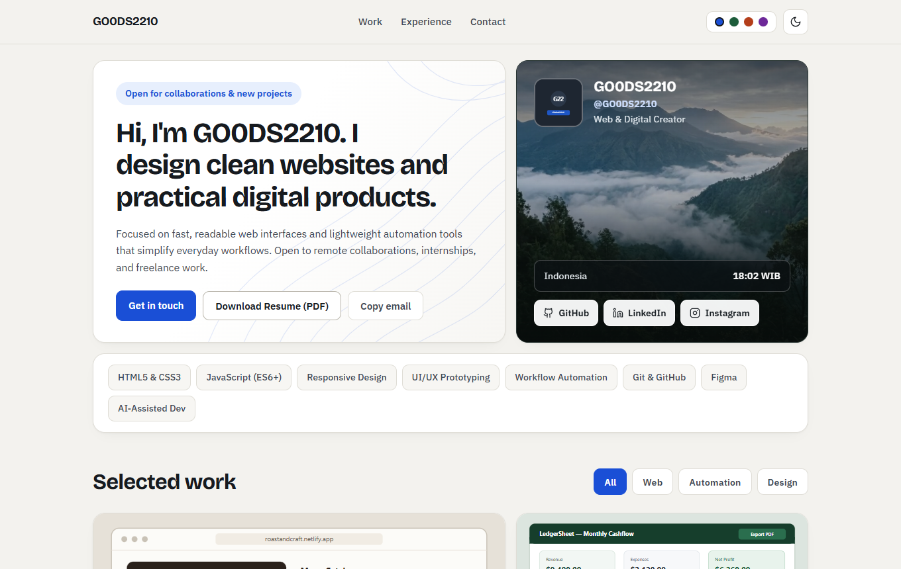
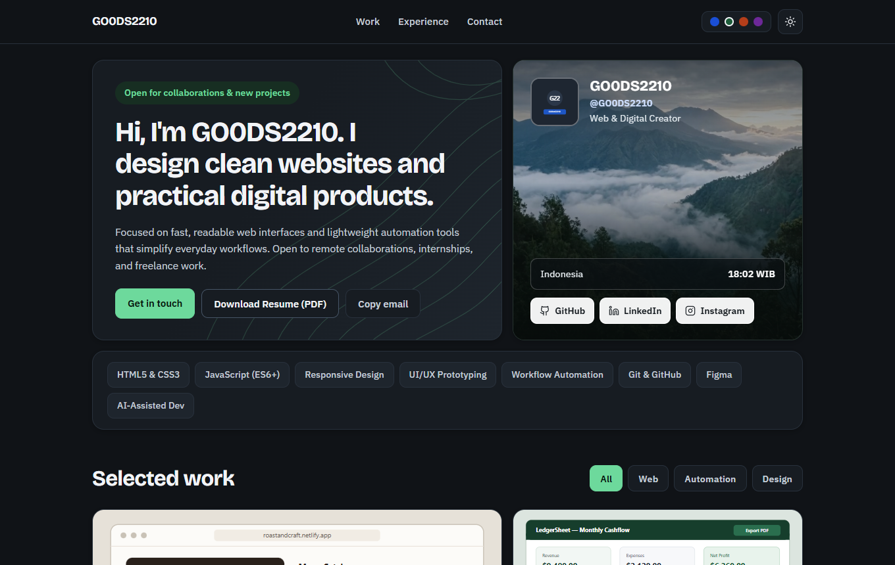
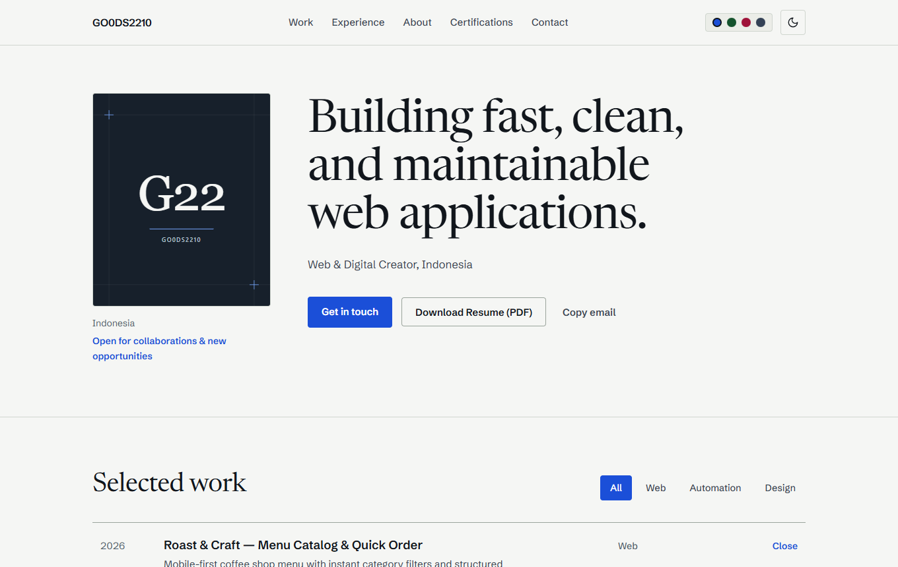

# BentoFolio

Minimal, static HTML/CSS/JS developer & designer portfolio template — zero Node.js, npm, or build tools required. Includes a **Tactile Bento** main edition (`./`) and an **Editorial Monograph** variant (`./editorial/`), both driven by a single `config.js` file.

> **Live Preview (after enabling GitHub Pages):**
> - Main Tactile Bento: `https://go0ds2210.github.io/bentofolio/`
> - Editorial Variant: `https://go0ds2210.github.io/bentofolio/editorial/`

---

## Screenshots

### Light Mode (Cobalt)


### Dark Mode (Matcha)


### Editorial Monograph Variant (`/editorial/`)


---

## Features

- **Zero-Build Architecture:** Pure HTML5, CSS3, and Vanilla JavaScript. Double-click `index.html` to preview locally or push straight to GitHub Pages / Netlify Drop.
- **Single-File Configuration (`config.js`):** Edit profile bio, portrait, project cards, experience timeline, certifications, email, and phone number in one place.
- **Interactive Profile Card:** Looping `.mp4` Indonesian highland backdrop (`assets/bg-indonesia.mp4`) with static poster fallback, subtle pointer 3D tilt, `prefers-reduced-motion` support, and configurable IANA timezone clock.
- **4 High-Contrast Color Presets + Light/Dark Mode:** `cobalt`, `matcha`, `terracotta`, and `plum` persisted in `localStorage`.
- **1-Click Client-Side PDF Resume Download (`resume-pdf.js`):** Automatically builds and downloads a clean A4 `.pdf` resume directly from `config.js` with zero external dependencies (or links to a custom `cvFileUrl`).
- **Two Complete Designs Included:** Tactile Bento grid in the root folder and a serif Editorial Monograph layout inside `editorial/`.

---

## Folder Structure

```text
bentofolio/
├── index.html            # Main Tactile Bento portfolio
├── style.css             # Responsive Bento styles, themes & @media print fallback
├── config.js             # Main configuration file (edit this)
├── resume-pdf.js         # Client-side A4 PDF resume generator
├── app.js                # DOM rendering, filter tabs, case study drawers & clock
├── assets/               # Portrait SVG, looping video backdrop, poster & SVG mockups
├── editorial/            # Alternative minimal serif portfolio (index.html + config.js)
├── docs/screenshots/     # Preview screenshots
├── LICENSE               # MIT License
└── .nojekyll             # Bypass Jekyll on GitHub Pages
```

---

## Quick Start

1. **Clone or fork** this repository:
   ```bash
   git clone https://github.com/GO0DS2210/bentofolio.git
   ```
2. Open **`config.js`** (and `editorial/config.js` if using the editorial layout) in any code/text editor and replace placeholder details (`profile`, `skills`, `projects`, `timeline`, `certifications`, `contact`).
3. Drop your portrait, project screenshots, or optional background `.mp4` inside `assets/`.
4. Leave `cvFileUrl: ""` blank to auto-generate a downloadable `.pdf` resume from `config.js`, or set `cvFileUrl: "assets/Your_Resume.pdf"`.
5. Preview locally by opening `index.html` in a browser.

---

## Free Hosting (GitHub Pages)

1. Go to **Settings → Pages** in your GitHub repository.
2. Under **Build and deployment → Source**, choose **Deploy from a branch**.
3. Select branch **`main`** and folder **`/ (root)`**, then click **Save**.
4. Both `/` and `/editorial/` will be live in ~1 minute.

*(Alternatively, drag & drop the root folder onto [Netlify Drop](https://app.netlify.com/drop) for an instant deployment.)*

---

## License

Released under the [MIT License](LICENSE). Feel free to customize, remix, and use it for personal or commercial portfolio sites.
